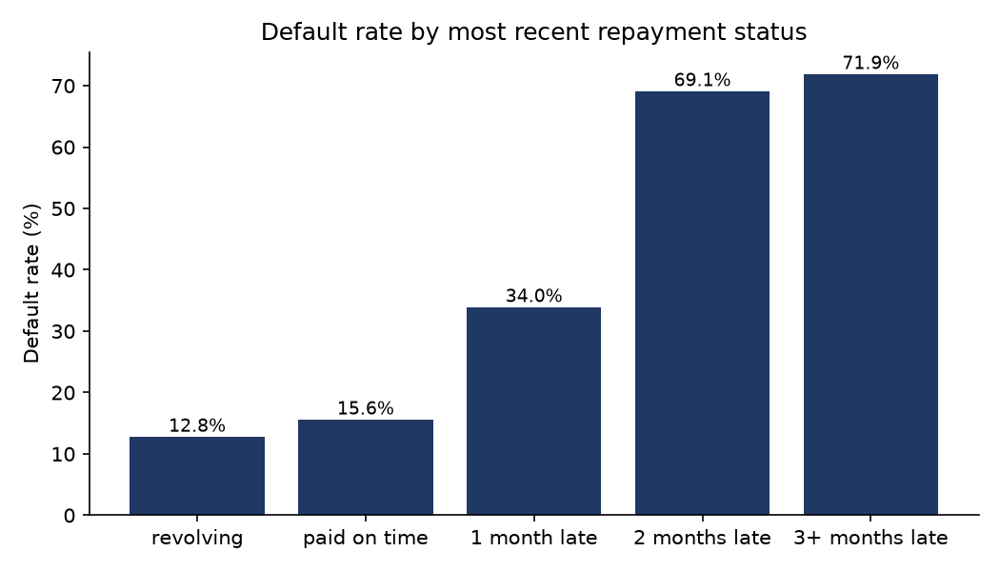
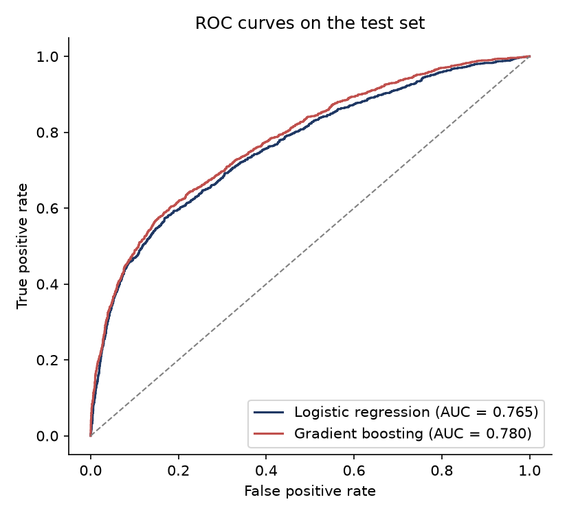

# Credit Risk Scoring — SQL & Python

Predicting which credit card clients will default on their next payment, using **SQL (SQLite)** for data storage, quality checks, analysis and feature engineering, and **Python (pandas, scikit-learn)** for modelling.

**Data:** *Default of Credit Card Clients*, UCI Machine Learning Repository (Yeh & Lien, 2009). 30,000 clients of a Taiwanese bank, April–September 2005, 22.1% default rate. Licence CC BY 4.0.

## Results

| Model | CV AUC (5 folds) | Test AUC | Gini | KS |
|---|---|---|---|---|
| Logistic regression | 0.778 ± 0.004 | 0.765 | 0.53 | 0.41 |
| Gradient boosting | 0.786 ± 0.006 | **0.780** | **0.56** | **0.42** |

- Gradient boosting is slightly better, but the logistic regression is close and fully interpretable, which matters for credit decisions.
- **Decision rule (logistic regression):** flagging the 20% riskiest clients catches **49%** of the defaulters, with a precision of **55%**, compared with a 22% base rate.
- **Strongest risk signal:** the most recent repayment status. Clients 2 months late default 69% of the time, against 13% for revolving clients.
- The default rate falls steadily with the credit limit, from 33% in the lowest quintile to 14% in the highest.




## Pipeline

| Step | File | What it does |
|---|---|---|
| 1 | `sql/01_schema.sql` | Creates the `clients` table |
| 1 | `sql/02_data_quality.sql` | Checks row count, duplicates, missing values, undocumented codes, negative bills |
| 1 | `sql/04_features.sql` | Builds the `client_features` view: utilisation, months late, payment ratio, status groups |
| 2 | `sql/03_analysis.sql` | Default rates by repayment status, age, education and credit-limit quintile (CTE + window function) |
| 3 | `src/step3_model.py` | Stratified 80/20 split, 5-fold cross-validation, logistic regression vs gradient boosting, AUC / Gini / KS, decision threshold |

## Modelling choices

- **Repayment status as a category**, not a number: "revolving" clients are *less* risky than those who paid in full, so the raw codes are not linear in risk.
- **Log transform of amounts** (credit limit, bill, payment) for the logistic regression, because they are heavily skewed.
- **Sex excluded** from the model: using gender in a credit decision raises fairness and legal issues.
- **No data leakage:** cross-validation runs on the training set only; the test set is used once, at the end.

## Limitations

- 2005 data from a single bank in Taiwan: results do not transfer directly to other markets.
- Payment ratio is a simplification (a payment in month *t* often settles the bill of month *t-1*).
- Probabilities are not calibrated; a production score would need calibration and monitoring over time.

## How to run

```bash
pip install -r requirements.txt
python src/run_all.py
```

The dataset is downloaded automatically into `data/` on the first run. Outputs are written to `results/` (CSV tables, `model_metrics.json`, figures).
